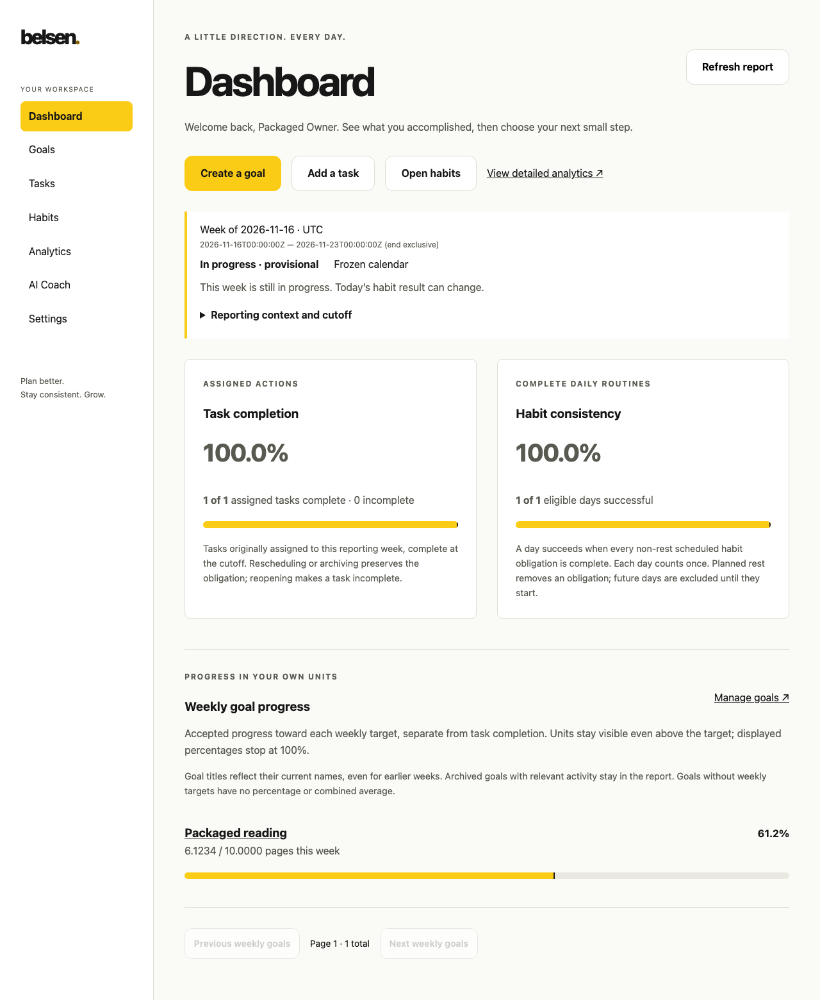
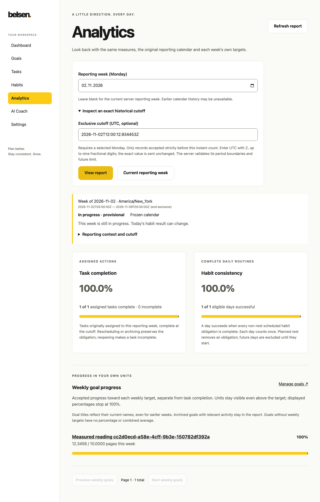

# Belsen-AI

**Plan better. Stay consistent. Grow.**

Java backend portfolio · Java 21 / Spring Boot / PostgreSQL / React

Belsen-AI helps people turn measurable goals into daily tasks and routines, then review what they actually accomplished. This personal portfolio project emphasizes Java backend engineering: ownership, concurrent writes, auditable history and trustworthy reporting.

| Public destination | Current status |
| --- | --- |
| Portfolio | Not deployed · future `https://<project>.pages.dev` |
| Interactive application | Not deployed · Oracle ARM proposed; no verified public URL |

| Daily workspace | Historical analytics |
| --- | --- |
| [](showcase/assets/dashboard.png) | [](showcase/assets/analytics.png) |

*Actual React interface captured against real Java/PostgreSQL backends; the dashboard capture uses the production JAR and local HTTPS. Fictional test data, not a live deployment or user statistics. [Analytics capture](showcase/assets/analytics.png) · [screenshot provenance](showcase/README.md#screenshot-provenance).*

## What works

| Area | Implemented behavior |
| --- | --- |
| Accounts | Email/password registration, secure sessions and profile/timezone settings |
| Goals | Explicit progress, weekly targets, idempotent submissions and auditable corrections |
| Tasks | Completion, reopening, rescheduling and immutable ordered history |
| Habits | Recurring schedules, daily check-ins, prospective rest and historical reconstruction |
| Dashboard and analytics | Weekly reports with frozen timezones, exact units and historical cutoffs |
| AI Coach | Explicit evidence preview and optional Groq ranking of Java-defined actions; disabled by default |
| Production packaging | React and REST in one Spring Boot JAR; HTTPS configuration and non-root runtime image |

**Free portfolio preparation:** the independent static showcase targets Cloudflare Pages Free, with [Git integration settings](docs/FREE_HOSTING.md#cloudflare-pages-git-settings). Oracle Always Free ARM is the proposed full Java/React/PostgreSQL route, subject to account/card verification, capacity and public HTTPS. Render Free is **not approved for production**; its experiment is retained separately. [Manual publication and hosting options](docs/FREE_HOSTING.md) · [local verification](docs/FREE_HOSTING_VERIFICATION.md).

**Existing VPS alternative:** a dedicated Hetzner/Caddy/PostgreSQL topology and encrypted backup tooling are prepared; see the [runbook](docs/DEPLOYMENT.md#hetzner-controlled-portfolio-preview). Production self-registration defaults off; approved individual accounts use an offline operator procedure. Local development explicitly permits signup.

**Release status:** the Java application and static showcase are not publicly deployed; no verified portfolio URL exists yet. GitHub reports the repository as **public**, verified November 27, 2026. Showcase source links remain hidden pending a separate privacy approval; the application launch link remains absent. The [tracked-file/history audit](docs/PUBLIC_SOURCE_AUDIT.md) records the accepted historical workstation-path disclosure and the current public-source review.

**Known limitations:** live Google login and live Groq inference remain unverified. Immutable report finalization, password recovery and email verification are not implemented. Closed reports are explicitly **closed, not finalized**. Login throttling is bounded to one application instance and resets on restart. No production uptime or complete accessibility certification is claimed.

## Engineering choices

Java 21 · Spring Boot 4.1.2 · Spring Security · Maven Wrapper 3.9.12 · PostgreSQL 17 · Flyway · React 19 · TypeScript · Vite · TanStack Query · Playwright.

The backend is a modular monolith organized by feature. PostgreSQL enforces ownership relationships, uniqueness and append-only history. Seven versioned Flyway migrations own schema changes; Hibernate validates the mappings. PostgreSQL Testcontainers verify the actual schema, constraints and transactions rather than an H2 approximation. Account-first locks coordinate writes, while dashboard reads use one read-only REPEATABLE READ snapshot.

- Task completion uses the **original due-week cohort** and completion state at the cutoff. Rescheduling or archive cannot erase an obligation.
- Habit consistency counts successful days. **Every non-rest scheduled habit must be complete** for a day to succeed.
- Goal progress uses explicit recorded units, independently of tasks. Missing data remains missing, rather than becoming a fabricated score.

The browser uses same-origin JDBC sessions and CSRF protection. Production cookies are Secure, HttpOnly and SameSite=Lax. Private resources are owner-scoped; stale mutations conflict instead of silently overwriting changes. The production SPA has an explicit route allowlist, HTTPS enforcement, security headers and no wildcard fallback for APIs or private files.

The optional Coach sends bounded numerical evidence and anonymous candidate IDs. The model selects IDs; Java owns metrics, action text and destinations. It cannot change user data. There are no automatic retries, paid fallback or page-load inference. Replay lasts 24 hours with 32-day idempotency tombstones; uncertain outcomes fail closed and retain capacity.

## Verification evidence and CI

| Layer | Local verification evidence |
| --- | --- |
| Java / PostgreSQL | Fresh: 307 tests, 92 unit and 215 integration |
| React | Fresh: 267 unit/component tests |
| Application Chromium | Reused: 52 cases across mocked, real PostgreSQL and packaged HTTPS suites |
| Standalone showcase | Fresh: 8 build tests; 8 desktop/mobile Chromium cases, including axe scans |

Fresh checks were completed November 27, 2026; application browser evidence is retained from the preceding release. These are local results, not a claim that GitHub Actions has already run. See [dated verification and limitations](docs/FREE_HOSTING_VERIFICATION.md) for fresh checks versus reused results. Mock OIDC and provider fixtures do not establish live Google or Groq behavior.

[The CI workflow](.github/workflows/ci.yml) prepares Node 24 showcase checks, frontend typecheck/lint/tests/build, desktop/mobile accessibility checks and Java 21 Maven verification against PostgreSQL Testcontainers on standard Ubuntu runners. It has read-only repository permission, pinned actions, no deployment step and no provider credentials. A focused publication guard checks recognized secret patterns and generated paths; it does not replace manual privacy review. Hosted results remain pending publication and execution of the workflow.

## Local backend setup

Requires Java 21, Docker with a running daemon, and network access for the first dependency/image download. Maven Wrapper pins Maven 3.9.12; a system Maven installation is not required.

Run from the repository root:

```sh
cp .env.example .env
```

Edit the ignored `.env`: fill the six required database values. Choose your own local password and shell-quote values containing special characters. Match both credential sets and use `jdbc:postgresql://127.0.0.1:5433/<your-database-name>` for the JDBC URL. If changing the database host port, update the URL too. Never commit `.env`.

```sh
docker compose --env-file .env -f infra/compose.yaml up -d --wait
set -a
. ./.env
set +a
SPRING_PROFILES_ACTIVE=local ./backend/mvnw -f backend/pom.xml spring-boot:run
```

Source only your trusted local `.env`. Compose reads that file explicitly; the backend needs the exported environment. The `local` profile binds the backend to loopback and permits HTTP cookies. Do not enable it in production. Without this profile, cookies require HTTPS.

Defaults are PostgreSQL `127.0.0.1:5433` and backend `127.0.0.1:8081`. Optional `BELSEN_POSTGRES_PORT` and `BELSEN_SERVER_PORT` overrides are documented in `.env.example`. Check ports again before starting. Compose uses project `belsen-ai` and volume `belsen-ai_postgres-data`; it does not manage TIR 2.0 resources.

In another terminal:

```sh
curl -i http://127.0.0.1:8081/api/v1/health
curl -i http://127.0.0.1:8081/api/v1/me
```

Expected responses are `200` with only `{"status":"UP"}` and `401` Problem Details, respectively. Health is a minimal process endpoint, not a continuous database-readiness probe. Startup requires working database configuration, migrations and schema validation. The unauthenticated `/me` request is rejected; authenticated sessions can read/update their own profile.

Stop the application with Ctrl-C. Stop only this project's database with `docker compose --env-file .env -f infra/compose.yaml stop`. The named volume persists; changing initialization credentials later does not reset an existing database.

## Frontend development

With the local backend running, use Node **24.x**:

```sh
cd frontend
npm ci
npm run dev
```

Open `http://localhost:5173`. Vite proxies the API and OAuth routes; keep the browser hostname consistent. Google is hidden unless its public build flag and backend configuration are both enabled. Credentials remain server-side.

## Build and verification

```sh
./scripts/build-production.sh
```

This runs locked frontend installation, typecheck, ESLint, unit tests and production build, then Maven `-Pspa clean verify` with real PostgreSQL Testcontainers. Docker is required; no H2 substitute or silent integration-test skip is used. Output is `backend/target/belsen-ai-0.0.1-SNAPSHOT.jar`.

Browser suites run from `frontend/` after packaging: `npm run e2e` (mocked shell), `npm run e2e:coach` (mocked Coach API), `npm run e2e:real` (real Java/PostgreSQL), `npm run e2e:packaged` (production JAR/local HTTPS), and `npm run e2e:coach:real` (real Java/PostgreSQL/HTTPS with a test-only ranking bean). Fixtures do not demonstrate live Google or Groq.

Retained backend checks cover the experimental Render guard, PostgreSQL certificate/hostname verification and a bounded Flyway pool. Focused portfolio checks cover the static build, desktop/mobile Chromium and accessibility; native ARM image and Compose rehearsals verify the proposed Oracle package locally. `node showcase/build.mjs` builds the public page without dependencies; its launch destination stays absent until explicitly configured. [Current results and resource measurements](docs/FREE_HOSTING_VERIFICATION.md) distinguish local simulations from actual provider verification.

See the [B4 release audit](docs/RELEASE_READINESS.md) for that checkpoint’s results, findings and external prerequisites. [Deployment instructions](docs/DEPLOYMENT.md) cover TLS, secrets, restricted proxy trust, backups, restore and rollback. Deployment needs separate approval and an explicit registration policy; the current MVP has no email verification or password reset.

## Explore the project

- [Architecture and tradeoffs](docs/ARCHITECTURE.md) · [technical decisions](docs/DECISIONS.md)
- [API contracts](docs/API.md) · [AI Coach design and privacy](docs/AI_COACH_DESIGN.md)
- [Product vision](docs/PRODUCT_VISION.md) · [roadmap](docs/ROADMAP.md)
- [Contributing](CONTRIBUTING.md) · [genuine screenshots](showcase/README.md#screenshot-provenance)

No license has been selected. Repository visibility, licensing and public hosting are owner decisions; a public source listing alone does not grant an open-source license.
